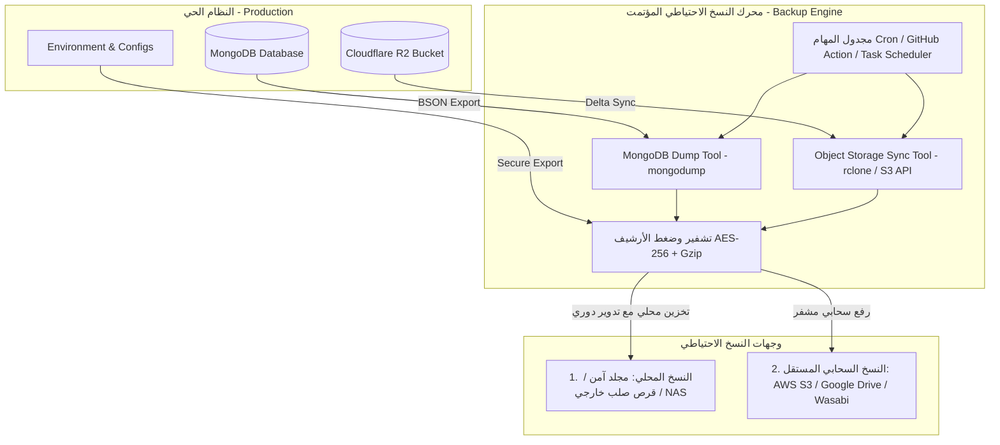

# 🛡️ خطة استراتيجية النسخ الاحتياطي الاحترافي (Professional Backup System)
## مشروع Nile Link Logistics & Customs System

---

## 1. المقدمة والأهداف (Objectives)
الهدف من هذه الخطة هو بناء نظام نسخ احتياطي آلي، مشفر، وموثوق لنظام **Nile Link** يضمن:
1. **RPO (Recovery Point Objective):** فقدان بيانات لا يتجاوز 6 - 24 ساعة (مع إمكانية تقليله لأقل من ساعة للعمليات المالية).
2. **RTO (Recovery Time Objective):** استعادة النظام بالكامل والتشغيل في مدة لا تتجاوز 15 - 30 دقيقة عند حدوث كارثة.
3. **تطبيق قاعدة النسخ العالمية 3-2-1:**
   - **3 نسخ** من البيانات (النسخة الحية + نسختان احتياطيتان).
   - **2 وسيط تخزين مختلف** (أقراص محلية مشفرة + تخزين سحابي مستقل).
   - **1 نسخة خارج الموقع (Off-site)** معزولة ومحمية ضد برمجيات الفدية والأخطاء البشرية.

---

## 2. حصر الأصول والبيانات الحساسة في النظام (Data Inventory)

| الأصل (Asset) | المكان الحالي (Current Location) | نوع البيانات الحساسة | درجة الحرجية |
| :--- | :--- | :--- | :---: |
| **قاعدة البيانات (MongoDB)** | MongoDB Atlas أو Self-Hosted MongoDB | الحسابات، العملاء، القيود المالية، المستندات، الشحنات، الفواتير | 🔴 حرجة جداً (Tier 1) |
| **الملفات والمرفقات الرقمية** | Cloudflare R2 (`nilelink-documents`) ومحلياً `storage/r2_local_fallback` | شهادات الجمارك، البوالص، فواتير الشحن، مستندات UCR، العقود الرسمية | 🔴 حرجة جداً (Tier 1) |
| **إعدادات البيئة والمفاتيح** | ملفات `.env`, Cloudflare Wrangler Vars & Secrets | مفاتيح الربط، كلمات السر، مفاتيح JWT و API Keys | 🟡 عالية (Tier 2) |
| **الكود والسكربتات** | GitHub Repositories (`system_nilelink`, `nile_link_system`) | كود المشروع والإصدارات التاريخية | 🟢 محمية تلقائياً بـ Git |

---

## 3. معمارية نظام النسخ الاحتياطي المقترحة (Architecture Diagram)

---

## 4. مستويات النسخ والتنفيذ (Backup Tiers)

### المستوى الأول: النسخ الاحتياطي لقاعدة البيانات (MongoDB)
* **الأداة:** `mongodump` عبر اتصال مشفر `mongodump --uri="MONGODB_URI" --gzip --archive=...`
* **صيغة الحفظ:** ملف أرشيف مضغوط واحد بلاحقة `.dump.gz`.
* **التشفير:** تشفير بكلمة سر قوية باستخدام `openssl enc -aes-256-cbc` أو مفتاح GPG قبل النقل أو الحفظ الخارجي.
* **الدورية المقترحة:**
  - نسخة يومية تلقائية (الساعة 2:00 صباحاً).
  - نقطة استرجاع سريعة عند أي ترقية كبرى للنظام (Pre-deployment Snapshot).

### المستوى الثاني: نسخ الملفات والمستندات (Cloudflare R2 / Local Storage)
* **المشكلة:** حجم المستندات ينمو مع الوقت، وإعادة تنزيل كل الملفات يومياً يستهلك سعة نقل وقت.
* **الحل الاحترافي (Incremental / Delta Sync):**
  - استخدام أداة مزامنة سريعة مثل `rclone` أو سكربت Node.js ذكي يفحص التغييرات فقط (Sync Delta).
  - نقل الملفات الجديدة والمعدلة فقط إلى مجلد النسخ الاحتياطي المحلي أو الحاوية السحابية الاحتياطية.
* **الدورية:** يومية أو أسبوعية للملفات التراكمية.

### المستوى الثالث: النسخ السحابي المزدوج (Cloud Off-site)
لضمان عدم الاعتماد الكلي على حاسوب واحد أو مزود سحابي واحد:
* **الخيارات المتاحة:**
  1. **Google Drive / OneDrive المؤسسي:** يتم الرفع التلقائي إليه عبر API أو Service Account.
  2. **AWS S3 / Wasabi / Backblaze B2:** تكلفة زهيدة جداً (أقل من 1 دولار شهرياً) مع تفعيل خاصية **Immutability (Object Lock)** لحماية النسخ من الحذف بالخطأ أو الاختراق.
  3. **R2 Multi-Region / Secondary Bucket:** إنشاء باكت احتياطي في حساب أو منطقة أخرى.

---

## 5. سياسة التدوير والحفظ (Retention Policy)
تعتمد على نظام **GFS (Grandfather-Father-Son)** لمنع استهلاك مساحات التخزين دون داعٍ:
* **النسخ اليومية (Daily):** الاحتفاظ بآخر **7 أيام**.
* **النسخ الأسبوعية (Weekly):** الاحتفاظ بنسخة كل أسبوع لمدة **4 أسابيع** (شهر كامل).
* **النسخ الشهرية (Monthly):** الاحتفاظ بنسخة أول كل شهر لمدة **3 إلى 6 أشهر**.
* **تنظيف تلقائي (Auto-Prune):** السكربت يقوم بحذف النسخ القديمة تلقائياً لتوفير المساحة.

---

## 6. خطة الاستعادة واختبار الطوارئ (Disaster Recovery & Restore Drills)
أي نظام نسخ احتياطي لا يتم اختباره يُعتبر نظاماً غير موجود!
1. **سكربت الاستعادة الفوري (`npm run restore` أو `restore.bat`):**
   - يقوم بفك تشفير الأرشيف.
   - تشغيل أمر `mongorestore --drop` لاستعادة البيانات إلى قاعدة البيانات.
   - التحقق من تكامل الجداول والمستندات (Data Integrity Check).
2. **محاكاة طوارئ دورية (Fire Drill):**
   - اختبار استعادة نسخة احتياطية على بيئة تجريبية (Staging / Local) كل شهر للتأكد من سلامة الملفات وأن كلمات فك التشفير صحيحة.

---

## 7. آلية التنبيهات والمراقبة (Alerting & Monitoring)
* في حال نجاح النسخ الاحتياطي أو فشله:
  - إرسال إشعار فوري (Email عبر Resend/Nodemailer، أو رسالة Telegram Bot / Discord Webhook).
  - تسجيل سجل تفصيلي بالعمليات (Audit Log) في مجلد `backups/logs/`.

---

## 8. مراحل التنفيذ المقترحة (Implementation Roadmap)

### المرحلة 1: إعداد السكربتات الأساسية (Core Scripts)
- [ ] إنشاء سكربت `scripts/backup/backup-db.ts` لعمل Dump مضغوط ومؤرخ لقاعدة بيانات MongoDB.
- [ ] إنشاء سكربت `scripts/backup/backup-files.ts` لعمل نسخة احتياطية من ملفات ومستندات العملاء.
- [ ] إنشاء سكربت `scripts/backup/prune.ts` لحذف النسخ التي تجاوزت مدة الاحتفاظ.
- [ ] إضافة أوامر في `package.json` مثل `npm run backup` و `npm run restore`.

### المرحلة 2: الأتمتة المحلية (Local Automation)
- [ ] عمل مهمة مجدولة على نظام التشغيل (Windows Task Scheduler أو Linux Cron) لتشغيل النسخ الاحتياطي التلقائي يومياً.
- [ ] تحديد مسار الحفظ المحلي الآمن.

### المرحلة 3: المزامنة السحابية (Cloud Integration)
- [ ] ربط السكربت بمزود سحابي خارجي (Google Drive أو AWS S3 أو B2) لرفع الأرشيفات تلقائياً.
- [ ] تفعيل تشفير AES-256 قبل الرفع السحابي.

### المرحلة 4: واجهة إدارة النسخ (Admin Dashboard View - اختياري)
- [ ] إضافة تبويب في لوحة تحكم الأدمن يعرض حالة آخر نسخة احتياطية مع زر "تحميل نسخة احتياطية يدوية الآن" وتاريخ آخر Backup ناجح.
