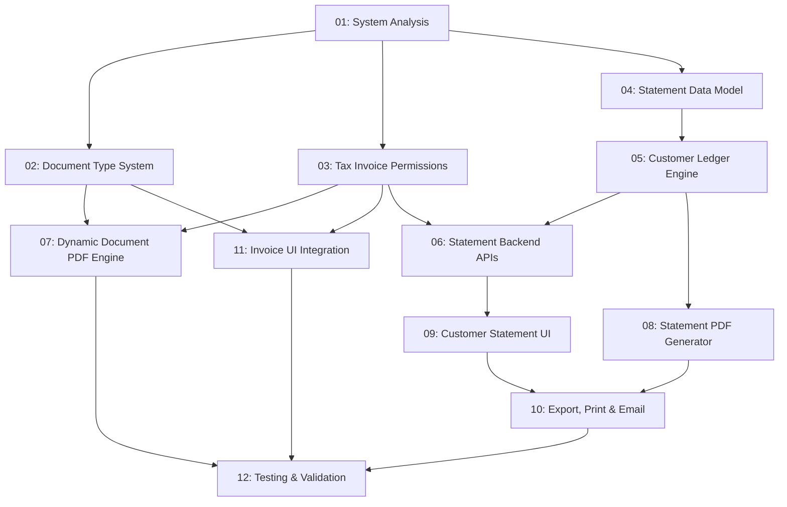

# Nile Link Logistics — Financial Document Types & Customer Statements
## Master Architectural Specification & Development Task Plan

---

## 1. Feature Overview

This master development plan outlines the complete engineering strategy to upgrade **Nile Link Logistics** with:
1. **Dynamic Financial Document Types**:
   - Decouple financial data from presentation titles.
   - Support three official document presentations:
     - **كشف حساب** (Account Statement) — *Default / Baseline Document Type*
     - **فاتورة** (Commercial Invoice)
     - **فاتورة ضريبية** (Official Tax Invoice)
   - Zero duplication of underlying financial records when switching presentation types.
2. **Tax Invoice Governance & Security**:
   - Protect "فاتورة ضريبية" under a dedicated operational permission: `issueTaxInvoice`.
   - Admin-configurable access per user/role.
   - Dual-layer protection: Hidden from unauthorized UI **AND** strictly blocked on backend API calls (HTTP 403 Forbidden).
3. **Customer Account Statements & Dynamic Ledger**:
   - Integrated inside the existing Customer Profile/Details page (`/admin/customers/[id]`).
   - Automatically aggregates live customer transactions (Shipments, Invoices, Payments, Surcharges).
   - Chronological double-entry ledger representation:
     - Columns: `Date | Description | Reference | Debit | Credit | Balance`
   - Executive balance summary:
     - **Opening Balance** (computed from transactions prior to selected `From Date`).
     - **Total Charges / Debits** in period.
     - **Total Payments / Credits** in period.
     - **Closing Balance** (Opening + Debits - Credits).
   - Date range filtering (`From Date -> To Date`) and transaction category filtering (`All`, `Shipments`, `Invoices`, `Payments`).
   - Corporate PDF generation with Nile Link Logistics branding and bilingual Arabic RTL layout.
   - In-app preview, one-click print, and direct customer email dispatch with PDF attachment.
4. **Data Integrity Guarantee**:
   - **No duplicate balance collections**. The statement operates purely as a dynamic, computed query layer over the real source-of-truth collections (`Invoice`, `Payment`, `CustomerRequest`).

---

## 2. Current Architecture Findings

An extensive audit of the repository revealed the following baseline technical facts:

| System / Module | Current Implementation | Architectural Finding & Gap |
|---|---|---|
| **Invoice Model** | [`lib/models/Invoice.ts`](file:///d:/khaled/nile_link_website-main/lib/models/Invoice.ts) | Features comprehensive amounts, immutable snapshots, and statuses (`draft`, `confirmed`, `sent`, `paid`, etc.). **Gap**: Lacks a `documentType` field; hardcodes assumptions that all records are commercial invoices. |
| **Payment Model** | [`lib/models/Payment.ts`](file:///d:/khaled/nile_link_website-main/lib/models/Payment.ts) | Model exists with `invoiceId`, `customerId`, `amount`, `paymentMethod`, `paymentDate`. **Gap**: Lacks a dedicated admin API endpoint to log incoming payments and credit entries against customer accounts. |
| **PDF Generator** | [`lib/services/invoice-pdf-generator.ts`](file:///d:/khaled/nile_link_website-main/lib/services/invoice-pdf-generator.ts) | Pure vector PDF engine using `pdfkit` and `naqqash` (Arabic RTL shaper). **Gap**: Line 78 hardcodes title `"COMMERCIAL INVOICE"`. Needs dynamic title parameterization and dedicated statement generator. |
| **Permissions** | [`lib/models/User.ts`](file:///d:/khaled/nile_link_website-main/lib/models/User.ts) & [`lib/auth/require-permission.ts`](file:///d:/khaled/nile_link_website-main/lib/auth/require-permission.ts) | `IStaffPermissions` only contains 3 basic keys (`canSendAlerts`, `canReviewDocuments`, `canManageCustomers`). Session JWT serializes these permissions. **Gap**: Needs financial permissions (`issueTaxInvoice`, `createInvoice`, `editInvoice`, `viewCustomerStatements`, `exportCustomerStatements`, `sendFinancialDocuments`). |
| **Customer Profile** | [`app/[locale]/admin/customers/[id]/page.tsx`](file:///d:/khaled/nile_link_website-main/app/%5Blocale%5D/admin/customers/%5Bid%5D/page.tsx) | Clean tabbed layout (`documents`, `invoices`, `governance`, `profile`). **Gap**: Needs a dedicated `"statements"` ("كشف الحساب المالي") tab with interactive ledger controls. |
| **Email Service** | [`lib/email/send.ts`](file:///d:/khaled/nile_link_website-main/lib/email/send.ts) | Existing multi-provider email service supporting binary PDF attachments (`EmailAttachment[]`). Fully ready for statement email dispatch. |

---

## 3. Final Task List & Breakdown

The implementation is broken down into 12 modular, sequential tasks:

```
tasks/invoice-statements/
├── README.md                                          # Master Implementation Plan (This file)
├── 01-analyze-current-financial-system.md              # Technical audit of existing codebase
├── 02-document-type-system.md                         # Document type schema & separation of data
├── 03-tax-invoice-and-financial-permissions.md         # RBAC, issueTaxInvoice guard, and staff UI
├── 04-customer-statement-data-model.md                 # Ledger contracts, types, and double-entry rules
├── 05-customer-ledger-calculation-engine.md            # Running balance, opening/closing balance math
├── 06-customer-statement-backend-api.md                # /api/admin/customers/[id]/statement & /payments
├── 07-dynamic-document-pdf-engine.md                   # Dynamic PDF titles & tax invoice disclosures
├── 08-customer-statement-pdf-generator.md              # Professional Nile Link Statement PDF service
├── 09-customer-statement-ui.md                         # Customer Details page tab & interactive table
├── 10-statement-export-print-and-email.md              # Print preview, PDF export, and email modal
├── 11-invoice-document-type-ui-integration.md          # Invoices table, create/edit modals, review drawer
└── 12-testing-and-validation.md                        # Security audits, calculation tests, E2E checks
```

---

## 4. Recommended Implementation Order & Dependency Flow



---

## 5. Architectural & System Changes

### 5.1 Database Changes
- **`Invoice` Schema ([`lib/models/Invoice.ts`](file:///d:/khaled/nile_link_website-main/lib/models/Invoice.ts))**:
  - Add `documentType`: `{ type: String, enum: ["statement", "invoice", "tax_invoice"], default: "statement", index: true }`.
  - Add compound index: `{ customerId: 1, issueDate: 1, status: 1 }`.
- **`User` Schema ([`lib/models/User.ts`](file:///d:/khaled/nile_link_website-main/lib/models/User.ts)) & `RoleConfig`**:
  - Extend `staffPermissions` sub-schema with:
    - `issueTaxInvoice: { type: Boolean, default: false }`
    - `createInvoice: { type: Boolean, default: true }`
    - `editInvoice: { type: Boolean, default: true }`
    - `viewCustomerStatements: { type: Boolean, default: true }`
    - `exportCustomerStatements: { type: Boolean, default: true }`
    - `sendFinancialDocuments: { type: Boolean, default: false }`
- **`Payment` Schema ([`lib/models/Payment.ts`](file:///d:/khaled/nile_link_website-main/lib/models/Payment.ts))**:
  - Add compound index: `{ customerId: 1, paymentDate: 1 }`.
- **Zero Schema Duplication**: No separate "CustomerStatement" or "CustomerBalance" collection is created.

### 5.2 API Changes
- **New Endpoints**:
  - `GET /api/admin/customers/[id]/statement`: Query customer ledger by date range and transaction type.
  - `GET /api/admin/customers/[id]/statement/pdf`: Stream vector statement PDF.
  - `POST /api/admin/customers/[id]/statement/send`: Email statement PDF to customer.
  - `POST /api/admin/payments`: Record incoming payment, link to invoice, and update ledger.
- **Modified Endpoints**:
  - `POST /api/admin/invoices`: Accept `documentType`; enforce `issueTaxInvoice` if `"tax_invoice"`.
  - `PUT /api/admin/invoices/[id]`: Allow updating `documentType` on drafts; enforce `issueTaxInvoice`.
  - `GET /api/admin/invoices/[id]/pdf`: Accept `?type=statement|invoice|tax_invoice`; enforce `issueTaxInvoice` on `tax_invoice`.

### 5.3 UI Changes
- **Customer Details Page ([`app/[locale]/admin/customers/[id]/page.tsx`](file:///d:/khaled/nile_link_website-main/app/%5Blocale%5D/admin/customers/%5Bid%5D/page.tsx))**:
  - New tab: **كشف الحساب المالي (Account Statement)**.
  - Component: `CustomerStatementTab.tsx` with date picker, quick presets, filter pills, 4 summary KPI cards, interactive ledger table, and action buttons.
  - Modal: `SendStatementDialog.tsx` for email dispatch.
- **Invoice Modals & Review Drawer**:
  - `CreateInvoiceModal.tsx` & `EditInvoiceModal.tsx`: Segmented control for document type (`كشف حساب` default, `فاتورة`, `فاتورة ضريبية` gated).
  - `InvoiceReviewDrawer.tsx`: Dropdown / split button to preview and download document under any permitted title.
  - `AdminInvoicesTable.tsx`: Document type badge and filter.
- **Staff & Permissions UI**:
  - `EditPermissionsModal.tsx` & `CreateStaffModal.tsx`: Toggles for financial and tax invoice permissions.

### 5.4 PDF Changes
- **Unified Invoice PDF Generator ([`lib/services/invoice-pdf-generator.ts`](file:///d:/khaled/nile_link_website-main/lib/services/invoice-pdf-generator.ts))**:
  - Dynamic title parameterization: `كشف حساب`, `فاتورة`, `فاتورة ضريبية`.
  - Official tax disclosures (Tax Card, VAT registration number, legal disclaimer) rendered when `tax_invoice` is selected.
- **New Statement PDF Generator ([`lib/services/statement-pdf-generator.ts`](file:///d:/khaled/nile_link_website-main/lib/services/statement-pdf-generator.ts))**:
  - Dedicated multi-page A4 statement document with repeating table headers, opening/closing balance ribbons, running ledger lines, bank payment remittance info, and page counters.

---

## 6. Risks & Mitigation Strategies

| Risk | Impact | Mitigation Strategy |
|---|---|---|
| **Unauthorized Tax Invoice Issuance** | Legal & Tax Compliance Violation | Dual-layer security: Gated in UI and strictly verified in backend route handlers using `assertStaffPermission(req, "issueTaxInvoice")`. |
| **Balance Desynchronization** | Accounting Errors & Customer Disputes | **Zero duplicate balance state**. Opening, running, and closing balances are computed live from active non-draft invoices and payments. |
| **Multi-page PDF Collisions** | Visual overlapping in customer-facing PDFs | PDFKit table break mathematics measuring row heights, auto-invoking `doc.addPage()` with recurring headers. |
| **Arabic Text Rendering Glitches** | Detached or reversed Arabic letters | Centralized formatting through `naqqash` (`shapeArabicText`) with Amiri font glyph binding. |
| **Timezone Boundary Skew** | Invoices omitted when filtering by `toDate` | Enforce end-of-day boundary parsing (`23:59:59.999Z`) for all `toDate` filter inputs. |

---

## 7. Backward Compatibility Considerations

1. **Existing Database Records**:
   - Invoices currently saved in MongoDB lack `documentType`. The schema default (`"statement"`) and route fallback logic guarantee they load seamlessly without validation errors.
2. **Existing Staff Accounts**:
   - Existing staff users without newly defined permission fields will evaluate `session.staffPermissions?.issueTaxInvoice ?? false` to `false`, adhering strictly to the principle of least privilege.
3. **Super Admin Access**:
   - `super_admin` role continues to bypass individual permission key checks, ensuring uninterrupted operational continuity for system administrators.
4. **Existing Endpoints & UI**:
   - Standard invoice creation, customer document verification, and shipment workflows remain 100% functional with zero regressions.

---

## 8. Final End-to-End Testing & Verification Checklist

- [ ] **Document Types**:
  - [ ] Default document type is `كشف حساب` on new invoices.
  - [ ] Invoice can be saved/displayed as `فاتورة`.
  - [ ] Changing document type does not duplicate financial rows or alter calculations.
- [ ] **Tax Invoice Security**:
  - [ ] Staff without `issueTaxInvoice` cannot see "فاتورة ضريبية" in create/edit modals.
  - [ ] Direct `POST /api/admin/invoices` with `documentType: "tax_invoice"` returns 403 Forbidden.
  - [ ] Direct `GET /api/admin/invoices/:id/pdf?type=tax_invoice` returns 403 Forbidden.
  - [ ] Admin can grant `issueTaxInvoice` to staff in Staff Management UI.
  - [ ] Authorized staff can create, preview, and download tax invoices with tax disclosure headers.
- [ ] **Customer Account Statement**:
  - [ ] Opening balance correctly aggregates pre-period transactions.
  - [ ] Ledger table displays transactions in chronological order.
  - [ ] Running balance strictly equals `Previous + Debit - Credit`.
  - [ ] Closing balance strictly equals `Opening + Total Debit - Total Credit`.
  - [ ] Date range filter updates summary and ledger entries dynamically.
  - [ ] Category filter pills (`All`, `Shipments`, `Invoices`, `Payments`) filter rows as expected.
- [ ] **PDF & Export**:
  - [ ] Statement PDF downloads with complete Nile Link branding and customer details.
  - [ ] Arabic text is cursive, connected, and properly RTL oriented.
  - [ ] Print preview formats cleanly without sidebar or web navigation artifacts.
- [ ] **Email Dispatch**:
  - [ ] Statement email dialog pre-fills customer email address.
  - [ ] Email delivers successfully with PDF attachment.
- [ ] **System Integrity**:
  - [ ] Zero duplicate balance tables or redundant documents in MongoDB.
  - [ ] All existing tests and routes pass with zero regressions.
