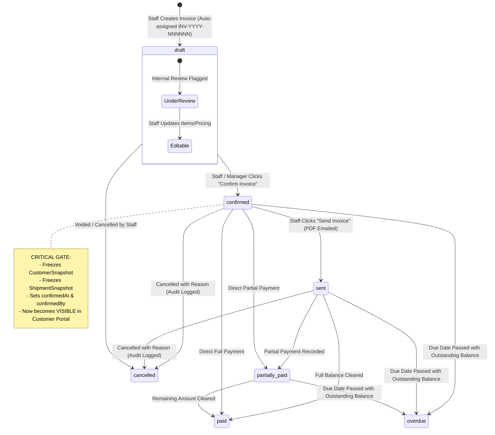
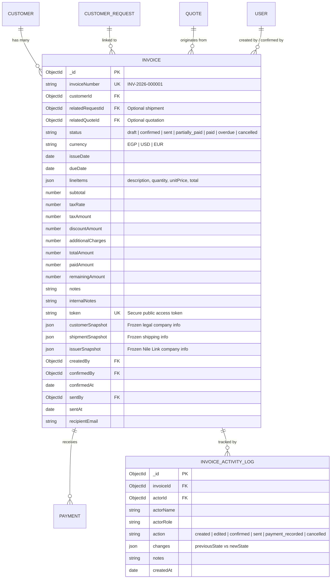

# Invoice Management System — Master Architecture & Implementation Overview

## 1. Feature Objective
The Nile Link Logistics Invoice Management System is an enterprise-grade financial documentation and billing workflow built natively into the existing Nile Link platform. It enables company staff and administrators to generate, calculate, review, confirm, and dispatch formal commercial logistics invoices, while allowing verified business customers to securely review, download, and track the status of their freight and clearance billings directly from their customer portal.

Key operational objectives:
1. **Internal Nile Link Control**: Complete invoice lifecycle management for staff (Draft creation, multi-item calculation, internal review, confirmation gate, sending, activity audit log).
2. **Customer Integration**: Seamless generation directly from Customer Details (`/admin/customers/[id]`) with pre-populated customer context, and self-service view/download inside Customer Portal (`/portal/financials`).
3. **Shipment / Operations Binding**: Direct association with `CustomerRequest` shipments (`/admin/requests/[id]`), carrying tracking numbers, customs clearance compliance codes (ACID / UCR), and services.
4. **Draft-to-Confirmed Security Barrier**: Strict authorization boundary where draft invoices are completely invisible to customers and customer-facing APIs until an authorized staff member explicitly approves ("Confirms") the invoice.
5. **Auditable & Immutable Snapshots**: Archival-grade immutability capturing exact customer address, legal tax registration, Nile Link corporate data, and shipment parameters at the exact moment of confirmation to maintain historical accounting integrity.
6. **Automated PDF & Direct Dispatch**: Clean, professional A4 PDF generation featuring the Nile Link brand identity, with one-click email dispatch directly to the customer's registered email via the existing email provider infrastructure (`lib/email`).

---

## 2. System Architecture & Component Mapping

```mermaid
graph TD
    subgraph Nile Link Staff / Admin Workspace
        AdminInvoicesList["/admin/invoices<br/>(Master Invoices Table)"]
        CustomerDetails["/admin/customers/[id]<br/>(Customer Profile)"]
        RequestDetails["/admin/requests/[id]<br/>(Shipment Details)"]
        CreateInvoiceModal["Create / Edit Invoice Modal<br/>(Reactive Calculation Engine)"]
    end

    subgraph Core Invoice Engine
        InvoiceModel["MongoDB: Invoice Collection<br/>(Draft / Confirmed / Sent / Paid)"]
        InvoiceSeq["MongoDB: InvoiceSequence<br/>(Atomic INV-YYYY-NNNNNN)"]
        InvoiceLog["MongoDB: InvoiceActivityLog<br/>(Audit Trail)"]
        CalcEngine["lib/engine/invoice-calculator.ts<br/>(Server-side Decimal Safe Calc)"]
        PDFGenerator["lib/services/invoice-pdf-generator.ts<br/>(A4 Corporate Branding)"]
        EmailService["lib/email/send.ts<br/>(Resend / SMTP with PDF Buffer)"]
    end

    subgraph Customer Portal
        PortalFinancials["/portal/financials<br/>(My Invoices Table)"]
        PortalLiveModal["InvoiceLivePreview Modal<br/>(Customer Preview)"]
        PublicInvoicePage["/invoice/[token]<br/>(Secure Public View / Print)"]
    end

    CustomerDetails -->|Click Create Invoice| CreateInvoiceModal
    RequestDetails -->|Click Create Invoice| CreateInvoiceModal
    AdminInvoicesList -->|New Invoice| CreateInvoiceModal
    CreateInvoiceModal -->|POST /api/admin/invoices (Draft)| InvoiceModel
    CreateInvoiceModal -->|Calc validation| CalcEngine
    InvoiceModel -->|Fetch Sequence| InvoiceSeq

    InvoiceModel -->|POST /api/admin/invoices/[id]/confirm| InvoiceModel
    InvoiceModel -->|Audit event| InvoiceLog
    InvoiceModel -->|POST /api/admin/invoices/[id]/send| EmailService
    EmailService -->|Generate Buffer| PDFGenerator
    EmailService -->|Dispatched to Customer| CustomerDetails

    InvoiceModel -.->|Only Confirmed / Sent / Paid| PortalFinancials
    PortalFinancials --> PortalLiveModal
    PortalLiveModal --> PublicInvoicePage
```

---

## 3. Invoice Lifecycle & State Machine

The invoice lifecycle is strictly governed to protect accounting records and prevent premature customer exposure:



### Lifecycle Status Definitions:
1. `draft`: Initial state upon creation. Fully editable. Invisible to customer portal. Cannot be sent to customer.
2. `confirmed`: Internal review complete. Values, customer legal details, and shipment info frozen into immutable snapshots. Visible to customer in portal. Ready for PDF download and direct email dispatch.
3. `sent`: Invoice PDF has been dispatched to customer's registered email via Nile Link's email engine. Delivery timestamps recorded.
4. `partially_paid`: Customer has made payments (`Payment` model), but `remainingAmount > 0`.
5. `paid`: Entire invoice `remainingAmount <= 0`.
6. `overdue`: Due date has elapsed and `remainingAmount > 0` (automated or cron updated).
7. `cancelled`: Invoice voided. Cannot receive payments or be re-sent. Reason captured in audit log.

---

## 4. Database Relationships



---

## 5. Security & Isolation Matrix

| Actor Role | View Drafts | Create Draft | Edit Draft | Confirm Invoice | Send Invoice | View Confirmed | Download PDF | Record Payment | Cancel Invoice |
|---|---|---|---|---|---|---|---|---|---|
| **Super Admin** | ✅ | ✅ | ✅ | ✅ | ✅ | ✅ | ✅ | ✅ | ✅ |
| **Staff (Finance/Ops)** | ✅ | ✅ | ✅ | ✅ (w/ perm) | ✅ | ✅ | ✅ | ✅ | ✅ (w/ perm) |
| **Customer Admin** | ❌ Forbidden | ❌ Forbidden | ❌ Forbidden | ❌ Forbidden | ❌ Forbidden | ✅ (Own Only) | ✅ (Own Only) | ❌ | ❌ |
| **Customer User** | ❌ Forbidden | ❌ Forbidden | ❌ Forbidden | ❌ Forbidden | ❌ Forbidden | ✅ (Own Only) | ✅ (Own Only) | ❌ | ❌ |
| **Public Link (Token)** | ❌ Blocked | ❌ | ❌ | ❌ | ❌ | ✅ (If Confirmed) | ✅ (If Confirmed) | ❌ | ❌ |

---

## 6. Implementation Roadmap & Phases

The complete implementation is broken down into 20 focused, sequentially executable task files under `tasks/invoice-system/`:

| Phase | Task File | Scope / Focus |
|---|---|---|
| **Foundation** | `01-current-system-analysis.md` | Deep codebase audit, existing models, APIs, security gap analysis |
| | `02-database-models.md` | Updating `Invoice.ts`, adding `InvoiceActivityLog.ts`, `InvoiceSequence.ts` |
| | `03-invoice-numbering.md` | Concurrency-safe, atomic sequential numbering (`INV-YYYY-NNNNNN`) |
| | `04-invoice-backend-api.md` | Core CRUD REST endpoints (`/api/admin/invoices`) with RBAC & validation |
| | `05-invoice-calculations.md` | Server-safe financial calculator engine (subtotal, tax, discounts, rounding) |
| **Internal Management** | `06-admin-invoice-list.md` | Admin invoices dashboard view (`/admin/invoices`) with summary KPI cards |
| | `07-create-invoice.md` | Modal & form for authoring new invoices with reactive item additions |
| | `08-edit-draft-invoice.md` | Editing and updating unconfirmed draft invoices with safety checks |
| **Workflows & Linking** | `09-customer-profile-integration.md` | Invoices tab inside `/admin/customers/[id]` with contextual prefilled creation |
| | `10-shipment-integration.md` | Linking shipments (`CustomerRequest`), prefilling service details |
| | `11-draft-confirm-workflow.md` | Review & confirmation gate, snapshot generation, immutability enforcement |
| **Portal & Documents** | `12-customer-portal-invoices.md` | Customer portal financials update, strict draft isolation, IDOR protection |
| | `13-invoice-notifications.md` | In-app notification integration for staff review and customer billing alerts |
| | `14-invoice-pdf.md` | A4 corporate PDF generation service with Nile Link branding & legal header |
| | `15-send-invoice.md` | Direct email delivery with attached PDF via existing email infrastructure |
| **Hardening & Quality** | `16-permissions-security.md` | Fine-grained RBAC permissions (`canManageInvoices`, `canConfirmInvoices`) |
| | `17-search-filtering.md` | Advanced search by invoice #, customer name, date range, status, currency |
| | `18-ui-ux-polish.md` | RTL/LTR bilingual Arabic/English translations, badges, animations, print CSS |
| | `19-testing.md` | End-to-end testing matrix, calculation boundary tests, concurrency stress tests |
| | `20-final-integration.md` | System rollout checklist, regression verification, and production handoff |
