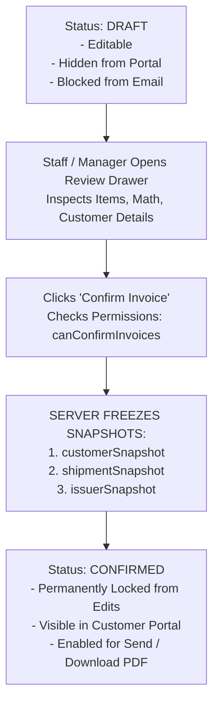

# Task 11 — Draft Review, Confirmation Gate & Snapshot Freezing

## 1. Task Name
Draft-to-Confirmed Operational Workflow, Review Drawer & Snapshot Freezing

## 2. Goal
Implement the central business workflow gate transitioning invoices from internal `draft` to legally binding `confirmed` status. Build the administrative review drawer, execute the atomic snapshot freezing of customer and shipment parameters, and unlock customer visibility while preventing future edits to the invoice document.

---

## 3. Existing System
- [lib/models/Invoice.ts](file:///d:/khaled/nile_link_website-main/lib/models/Invoice.ts): Data model holding snapshots and confirmation metadata.
- [lib/models/InvoiceActivityLog.ts](file:///d:/khaled/nile_link_website-main/lib/models/InvoiceActivityLog.ts): Audit log collection.
- [lib/models/SystemSetting.ts](file:///d:/khaled/nile_link_website-main/lib/models/SystemSetting.ts): Nile Link legal issuer info source.
- [components/admin/review/DocumentReviewModal.tsx](file:///d:/khaled/nile_link_website-main/components/admin/review/DocumentReviewModal.tsx): Reference pattern for review interfaces.

---

## 4. Requirements & State Transition Gate

### 4.1 Transition Contract


### 4.2 Snapshot Freezing Protocol
At the exact microsecond of confirmation, the server constructs and permanently writes the following snapshots into the invoice document:
1. **`customerSnapshot`**:
   - Fetches current `Customer` record.
   - Extracts: `companyName`, `commercialRegisterNumber`, `taxCardNumber`, `address`, `city`, `country`, `contactPhone`, `contactEmail`.
2. **`shipmentSnapshot`** (if `relatedRequestId` is present):
   - Fetches current `CustomerRequest`.
   - Extracts: `trackingNumber`, `serviceType`, `complianceType`, `complianceNumber`, `origin`, `destination`.
3. **`issuerSnapshot`**:
   - Extracts current Nile Link corporate details (legal name, Alexandria/Cairo office address, corporate tax ID, bank routing info).

---

## 5. Technical Implementation Details

### 5.1 Confirmation API: `POST /api/admin/invoices/[id]/confirm`
```typescript
import { NextRequest, NextResponse } from "next/server"
import { connectDB } from "@/lib/mongodb"
import { Invoice, Customer, CustomerRequest, InvoiceActivityLog } from "@/lib/models"
import { getSessionFromRequest } from "@/lib/auth/token-service"

export async function POST(
  req: NextRequest,
  { params }: { params: Promise<{ id: string }> }
) {
  try {
    const session = await getSessionFromRequest(req)
    if (!session || (session.role !== "staff" && session.role !== "super_admin")) {
      return NextResponse.json({ error: "Unauthorized" }, { status: 401 })
    }

    const { id } = await params
    await connectDB()

    const invoice = await Invoice.findById(id)
    if (!invoice) {
      return NextResponse.json({ error: "Invoice not found" }, { status: 404 })
    }

    // STRICT GATE: Only drafts can be confirmed
    if (invoice.status !== "draft") {
      return NextResponse.json(
        { error: `Invoice is already in '${invoice.status}' status and cannot be re-confirmed.` },
        { status: 400 }
      )
    }

    // Fetch customer data for snapshot
    const customer = await Customer.findById(invoice.customerId).lean()
    if (!customer) {
      return NextResponse.json({ error: "Associated customer not found" }, { status: 400 })
    }

    const customerSnapshot = {
      companyName: customer.companyName,
      commercialRegisterNumber: customer.commercialRegisterNumber,
      taxCardNumber: customer.taxCardNumber,
      address: customer.address || "",
      city: customer.city || "Cairo",
      country: customer.country || "Egypt",
      contactPhone: customer.contactPhone,
      contactEmail: customer.contactEmail,
    }

    // Fetch shipment data for snapshot if bound
    let shipmentSnapshot = undefined
    if (invoice.relatedRequestId) {
      const request = await CustomerRequest.findById(invoice.relatedRequestId).lean() as any
      if (request) {
        shipmentSnapshot = {
          requestId: request._id.toString(),
          trackingNumber: request.trackingNumber,
          serviceType: request.serviceType || "Freight Service",
          complianceType: request.complianceType || null,
          complianceNumber: request.complianceNumber || "",
          origin: request.details?.originPort || request.details?.pickupAddress || "",
          destination: request.details?.destinationPort || request.details?.deliveryAddress || "",
        }
      }
    }

    const issuerSnapshot = {
      legalName: "Nile Link Logistics S.A.E",
      address: "123 Maritime Blvd, Alexandria, Egypt",
      taxId: "994-123-456",
      phone: "+20 100 123 4567",
      email: "billing@nilelink.com",
      bankName: "Commercial International Bank (CIB)",
      bankAccountName: "Nile Link Logistics SAE",
      bankIban: "EG3800100000000001234567890",
      bankSwift: "CIBEEGCX",
    }

    // Update Invoice atomically
    invoice.status = "confirmed"
    invoice.confirmedBy = session.userId as any
    invoice.confirmedAt = new Date()
    invoice.customerSnapshot = customerSnapshot
    invoice.shipmentSnapshot = shipmentSnapshot
    invoice.issuerSnapshot = issuerSnapshot

    await invoice.save()

    // Record audit event
    await InvoiceActivityLog.create({
      invoiceId: invoice._id,
      customerId: invoice.customerId,
      actorId: session.userId,
      actorName: `${session.firstName} ${session.lastName}`,
      actorRole: session.role,
      action: "confirm",
      notes: "Invoice reviewed and officially confirmed for billing.",
      newState: { status: "confirmed", confirmedAt: invoice.confirmedAt },
    })

    return NextResponse.json({ success: true, invoice })
  } catch (error: any) {
    console.error("Confirm Invoice Error:", error)
    return NextResponse.json({ error: error.message || "Failed to confirm invoice" }, { status: 500 })
  }
}
```

### 5.2 UI Review Drawer: `components/admin/invoices/InvoiceReviewDrawer.tsx`
- Slide-over panel (or dialog) rendering full preview of the draft invoice.
- Displays calculated line items, client details, and shipment references.
- Primary CTA: **"Confirm Invoice"** (prominent green/emerald button with ShieldCheck icon).
- Secondary CTA: **"Edit Draft"** (opens `EditInvoiceModal`).
- Tertiary CTA: **"Cancel / Void Draft"**.

---

## 6. Security Considerations
- Permission check: Only staff with `canConfirmInvoices` or `super_admin` can confirm invoices.
- Immutability enforcement: Once confirmed, `PUT /api/admin/invoices/[id]` will permanently reject edits.
- Customer Isolation: Prior to this transition, customer portal API excludes the record completely.

---

## 7. Edge Cases Handled
- **Customer Details Changed During Drafting**: Handled automatically; snapshot fetches fresh customer details at the exact moment of confirmation.
- **Empty Line Items**: Confirmation fails if `items.length === 0` or `totalAmount <= 0`.
- **Double Confirmation Clicks**: Handled via idempotency check: `if (invoice.status !== "draft") return 400`.

---

## 8. Acceptance Criteria
- [ ] `POST /api/admin/invoices/[id]/confirm` transitions status to `confirmed`.
- [ ] Confirmation permanently captures `customerSnapshot`, `shipmentSnapshot`, and `issuerSnapshot`.
- [ ] `confirmedBy` and `confirmedAt` are recorded accurately.
- [ ] Audit log entry with action `confirm` is created.
- [ ] Following confirmation, the invoice becomes visible in Customer Portal financials.
- [ ] Subsequent attempts to edit the invoice are strictly rejected.

---

## 9. Testing Instructions
1. Create a draft invoice.
2. Verify it is NOT returned in `/api/portal/financials`.
3. Open review drawer and click "Confirm Invoice".
4. Check MongoDB: verify `status: "confirmed"`, snapshots populated, `confirmedBy` assigned.
5. Check Customer Portal: verify the invoice now appears in `/portal/financials`.
6. Attempt to modify the invoice via `PUT /api/admin/invoices/[id]`; verify 400 rejection.

---

## 10. Dependencies
- Depends on: `02-database-models.md`, `04-invoice-backend-api.md`, `08-edit-draft-invoice.md`
- Pre-requisite for: `12-customer-portal-invoices.md`, `14-invoice-pdf.md`, `15-send-invoice.md`
