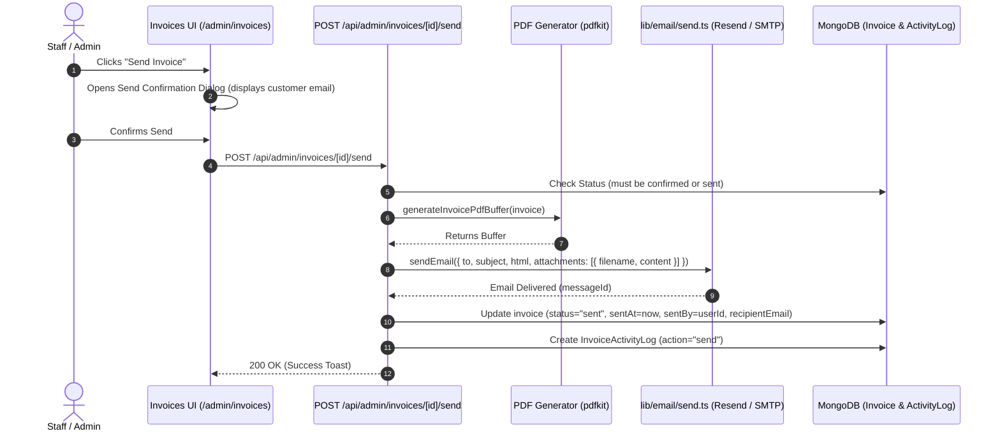

# Task 15 — Direct Email Delivery & PDF Attachment Pipeline

## 1. Task Name
One-Click Direct Email Dispatch & PDF Attachment Pipeline

## 2. Goal
Enable staff to dispatch invoices directly to customers with a single click. The system generates the official A4 PDF, attaches it to a branded HTML email using the project's existing email infrastructure (`lib/email`), delivers it to the customer's registered email, updates the invoice status to `sent`, and permanently logs dispatch metadata (`sentAt`, `sentBy`, `recipientEmail`).

---

## 3. Existing System
- [lib/email/send.ts](file:///d:/khaled/nile_link_website-main/lib/email/send.ts): Central email dispatch wrapper.
- [lib/email/types.ts](file:///d:/khaled/nile_link_website-main/lib/email/types.ts): Email options interface (`SendEmailOptions`).
- [lib/email/providers/resend.ts](file:///d:/khaled/nile_link_website-main/lib/email/providers/resend.ts): Resend HTTP API provider.
- [lib/email/providers/smtp.ts](file:///d:/khaled/nile_link_website-main/lib/email/providers/smtp.ts): Nodemailer SMTP provider.
- [lib/services/invoice-pdf-generator.ts](file:///d:/khaled/nile_link_website-main/tasks/invoice-system/14-invoice-pdf.md): PDF buffer generator.

---

## 4. Requirements & Workflow

### 4.1 Dispatch Workflow


---

## 5. Technical Implementation Details

### 5.1 Enhancing Email Infrastructure
1. **Update `lib/email/types.ts`**:
   ```typescript
   export interface EmailAttachment {
     filename: string
     content: Buffer | string
     contentType?: string
   }

   export interface SendEmailOptions {
     to: string
     subject: string
     html: string
     attachments?: EmailAttachment[]
   }
   ```

2. **Update `lib/email/providers/resend.ts`**:
   Pass attachments array to Resend REST API:
   ```typescript
   const payload: any = {
     from: config.from,
     to: [options.to],
     subject: options.subject,
     html: options.html,
   }

   if (options.attachments && options.attachments.length > 0) {
     payload.attachments = options.attachments.map((att) => ({
       filename: att.filename,
       content: Buffer.isBuffer(att.content) ? att.content.toString("base64") : att.content,
     }))
   }
   ```

3. **Update `lib/email/providers/smtp.ts`**:
   Pass attachments directly to Nodemailer:
   ```typescript
   const info = await transporter.sendMail({
     from,
     to: options.to,
     subject: options.subject,
     html: options.html,
     attachments: options.attachments,
   })
   ```

### 5.2 HTML Email Template: `lib/email/templates/invoice-email.ts`
- Clean, corporate HTML template matching Nile Link brand identity.
- Displays invoice number, issue date, due date, total amount, tracking reference, and remittance instructions.
- Prominent button linking to `/invoice/[token]`.
- Notes that the official commercial invoice PDF is attached.

### 5.3 Dispatch API: `POST /api/admin/invoices/[id]/send`
```typescript
import { NextRequest, NextResponse } from "next/server"
import { connectDB } from "@/lib/mongodb"
import { Invoice, Customer, InvoiceActivityLog } from "@/lib/models"
import { getSessionFromRequest } from "@/lib/auth/token-service"
import { generateInvoicePdfBuffer } from "@/lib/services/invoice-pdf-generator"
import { sendEmail } from "@/lib/email/send"
import { getInvoiceEmailTemplate } from "@/lib/email/templates/invoice-email"

export async function POST(
  req: NextRequest,
  { params }: { params: Promise<{ id: string }> }
) {
  try {
    const session = await getSessionFromRequest(req)
    if (!session || (session.role !== "staff" && session.role !== "super_admin")) {
      return NextResponse.json({ error: "Unauthorized" }, { status: 401 })
    }

    const { id } = await params
    await connectDB()

    const invoice = await Invoice.findById(id).populate("customerId")
    if (!invoice) {
      return NextResponse.json({ error: "Invoice not found" }, { status: 404 })
    }

    // STRICT GATE: Drafts cannot be sent
    if (invoice.status === "draft") {
      return NextResponse.json(
        { error: "Draft invoices cannot be sent to customers. The invoice must be reviewed and confirmed first." },
        { status: 400 }
      )
    }

    const customer = invoice.customerSnapshot || (invoice.customerId as any)
    const recipientEmail = customer.contactEmail

    if (!recipientEmail) {
      return NextResponse.json({ error: "Customer does not have a registered contact email." }, { status: 400 })
    }

    // 1. Generate PDF Buffer
    const pdfBuffer = await generateInvoicePdfBuffer(invoice)

    // 2. Build Email Content
    const emailHtml = getInvoiceEmailTemplate({
      customerName: customer.companyName,
      invoiceNumber: invoice.invoiceNumber,
      totalAmount: invoice.totalAmount,
      currency: invoice.currency,
      dueDate: invoice.dueDate,
      token: invoice.token,
    })

    // 3. Dispatch via Existing Email Provider
    await sendEmail({
      to: recipientEmail,
      subject: `Commercial Invoice ${invoice.invoiceNumber} — Nile Link Logistics`,
      html: emailHtml,
      attachments: [
        {
          filename: `${invoice.invoiceNumber}.pdf`,
          content: pdfBuffer,
          contentType: "application/pdf",
        },
      ],
    })

    // 4. Update Invoice Document & Record Audit Log
    if (invoice.status === "confirmed") {
      invoice.status = "sent"
    }
    invoice.sentBy = session.userId as any
    invoice.sentAt = new Date()
    invoice.recipientEmail = recipientEmail
    await invoice.save()

    await InvoiceActivityLog.create({
      invoiceId: invoice._id,
      customerId: invoice.customerId,
      actorId: session.userId,
      actorName: `${session.firstName} ${session.lastName}`,
      actorRole: session.role,
      action: "send",
      notes: `Invoice PDF dispatched to ${recipientEmail}`,
    })

    return NextResponse.json({ success: true, message: `Invoice successfully sent to ${recipientEmail}` })
  } catch (error: any) {
    console.error("Send Invoice Error:", error)
    return NextResponse.json({ error: error.message || "Failed to send invoice" }, { status: 500 })
  }
}
```

---

## 6. Files To Create
- `lib/email/templates/invoice-email.ts`
- `app/api/admin/invoices/[id]/send/route.ts`
- `components/admin/invoices/SendInvoiceDialog.tsx`

## 7. Files To Modify
- `lib/email/types.ts`
- `lib/email/providers/resend.ts`
- `lib/email/providers/smtp.ts`

---

## 8. Security Considerations
- **Draft Blocker**: Strict backend barrier preventing accidental dispatch of unconfirmed drafts.
- **Recipient Validation**: Email format strictly validated against RFC standards before execution.
- **Dev Mode Fallback**: Reuses existing mock email logger in dev environments if `RESEND_API_KEY` is absent.

---

## 9. Acceptance Criteria
- [ ] `SendEmailOptions` supports binary attachments in both Resend and SMTP providers.
- [ ] "Send Invoice" button prompts confirmation with target recipient email address.
- [ ] Attempting to send a `draft` invoice is blocked with HTTP 400.
- [ ] Upon successful dispatch, invoice status updates to `sent`, and `sentAt` / `sentBy` are recorded.
- [ ] `InvoiceActivityLog` records the dispatch event with the exact destination email.

---

## 10. Testing Instructions
1. In dev environment, open a confirmed invoice.
2. Click "Send Invoice". Confirm modal.
3. Observe console output verifying mock email dispatch with attachment filename `${invoice.invoiceNumber}.pdf`.
4. Check invoice status in database: verify status changed to `sent`, `sentAt` is populated, and audit log entry exists.

---

## 11. Dependencies
- Depends on: `02-database-models.md`, `11-draft-confirm-workflow.md`, `14-invoice-pdf.md`
- Pre-requisite for: `16-permissions-security.md`
