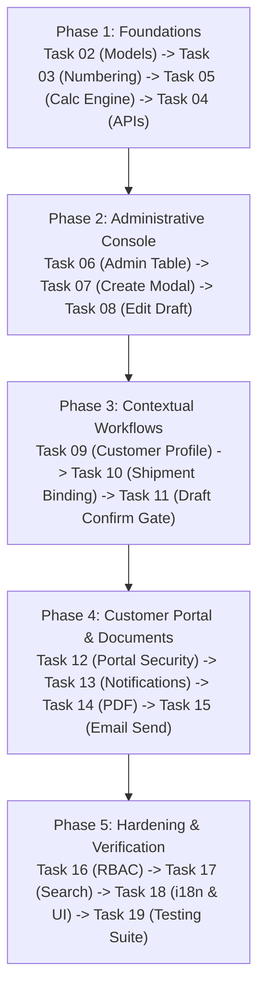

# Task 20 — Production Rollout, Migration Plan & Final Sign-Off

## 1. Task Name
Production Deployment Checklist, Data Migration & Final System Sign-Off

## 2. Goal
Provide the complete production deployment playbook, database initialization, migration scripts for existing records, sanity audit checklist, and final system integration verification for the Nile Link Logistics Invoice Management System.

---

## 3. Recommended Sequential Implementation Order

When transitioning from planning to implementation, an AI coding agent or engineer should execute the tasks in this exact order:



1. **Step 1: Core Models & Schemas** (`02-database-models.md`)
   - Update `lib/models/Invoice.ts`, create `InvoiceSequence.ts` and `InvoiceActivityLog.ts`, export in `index.ts`.
2. **Step 2: Calculations & Numbering** (`03-invoice-numbering.md`, `05-invoice-calculations.md`)
   - Create `lib/engine/invoice-calculator.ts` and `lib/services/invoice-number-service.ts`.
3. **Step 3: Core Backend APIs** (`04-invoice-backend-api.md`)
   - Create `/api/admin/invoices` and `/api/admin/invoices/[id]`.
4. **Step 4: Admin Management Interface** (`06-admin-invoice-list.md`, `07-create-invoice.md`, `08-edit-draft-invoice.md`)
   - Build `/admin/invoices` page, table, and authoring modal. Update `AdminSidebar.tsx`.
5. **Step 5: Operational Bindings** (`09-customer-profile-integration.md`, `10-shipment-integration.md`, `11-draft-confirm-workflow.md`)
   - Integrate Invoices tab into `/admin/customers/[id]`, link shipments in `/admin/requests/[id]`, implement `confirm` endpoint with snapshot freezing.
6. **Step 6: Customer Portal & IDOR Barrier** (`12-customer-portal-invoices.md`)
   - Patch `/api/portal/financials` and `/api/invoice/[token]` to exclude drafts. Wire up view/print in customer portal.
7. **Step 7: Notifications, PDF & Email** (`13-invoice-notifications.md`, `14-invoice-pdf.md`, `15-send-invoice.md`)
   - Install `pdfkit` (and types), build A4 PDF generator, update `SendEmailOptions`, build email template and dispatch API.
8. **Step 8: Hardening, Polish & Tests** (`16-permissions-security.md`, `17-search-filtering.md`, `18-ui-ux-polish.md`, `19-testing.md`)
   - Update permissions, add translations in `messages/en.json` and `messages/ar.json`, run test matrix.

---

## 4. Database Migration Script: `scripts/migrate-invoices.ts`

For existing development or staging database environments that contain legacy invoice records:
```typescript
import { connectDB } from "../lib/mongodb"
import { Invoice, InvoiceSequence } from "../lib/models"

export async function migrateExistingInvoices() {
  await connectDB()
  console.log("Starting Invoice Data Migration...")

  // 1. Initialize 2026 Sequence if not present
  const currentYear = new Date().getFullYear()
  const seqKey = `INV_${currentYear}`
  const existingSeq = await InvoiceSequence.findById(seqKey)
  if (!existingSeq) {
    const highestExisting = await Invoice.countDocuments()
    await InvoiceSequence.create({ _id: seqKey, seq: highestExisting })
    console.log(`Initialized sequence ${seqKey} to ${highestExisting}`)
  }

  // 2. Backfill missing snapshots or defaults for existing invoices
  const cursor = Invoice.find({
    $or: [
      { additionalCharges: { $exists: false } },
      { taxRate: { $exists: false } },
      { internalNotes: { $exists: false } },
    ],
  }).cursor()

  let count = 0
  for (let doc = await cursor.next(); doc != null; doc = await cursor.next()) {
    if (doc.additionalCharges === undefined) doc.additionalCharges = 0
    if (doc.taxRate === undefined) doc.taxRate = 14
    if (doc.internalNotes === undefined) doc.internalNotes = ""
    await doc.save()
    count++
  }

  console.log(`Migration complete. Updated ${count} legacy invoices.`)
}
```

---

## 5. Pre-Flight Production Verification Checklist

### Functional Completeness
- [ ] Internal staff can view, filter, and search invoices at `/admin/invoices`.
- [ ] Staff can create draft invoices with auto-calculated line items, discounts, and VAT.
- [ ] Draft invoices can be revised or deleted prior to confirmation.
- [ ] Staff inside `/admin/customers/[id]` can click "+ Create Invoice" with customer pre-selected.
- [ ] Staff inside `/admin/requests/[id]` can click "Issue Commercial Invoice" with shipment bound.
- [ ] Clicking "Confirm Invoice" permanently freezes snapshots (`customerSnapshot`, `shipmentSnapshot`, `issuerSnapshot`).
- [ ] Confirmed invoices are locked against editing.
- [ ] Confirmed invoices appear inside the customer's portal at `/portal/financials`.
- [ ] Draft invoices are 100% invisible to customer portal queries and token links.
- [ ] "Send Invoice" generates official A4 PDF, attaches to email, and logs delivery.
- [ ] A4 PDF contains Nile Link brand logo, structured parties, item table, and bank remittance.
- [ ] Both English (LTR) and Arabic (RTL) translations are complete and verified.

### Security & Compliance
- [ ] IDOR protection: Customers can never query or download another client's invoice.
- [ ] RBAC protection: Non-staff cannot access admin invoice endpoints.
- [ ] Mathematical calculations executed strictly server-side (tamper-proof).
- [ ] Sequential numbering (`INV-YYYY-NNNNNN`) atomic and duplicate-proof.
- [ ] ReDoS sanitized query inputs.
- [ ] Internal staff notes never transmitted to customers.

---

## 6. Rollback Strategy
If any unforeseen production anomaly occurs during deployment:
1. Revert `AdminSidebar.tsx` navigation link from `/admin/invoices` back to `/admin/coming-soon/financials`.
2. The core database changes in `Invoice.ts` are backwards-compatible additions and will not break any existing customer or shipment records.
3. Customer portal query retains the `status: { $ne: "draft" }` filter, which is an immediate security enhancement that should stay active regardless.

---

## 7. Sign-Off & Status
- **Plan Status**: Complete, audited, and ready for sequential execution.
- **Production Code Status**: Untouched (planning only completed as instructed).
- **Execution Ready**: All 21 task files under `tasks/invoice-system/` contain explicit schemas, contracts, UI diagrams, and test guides.
